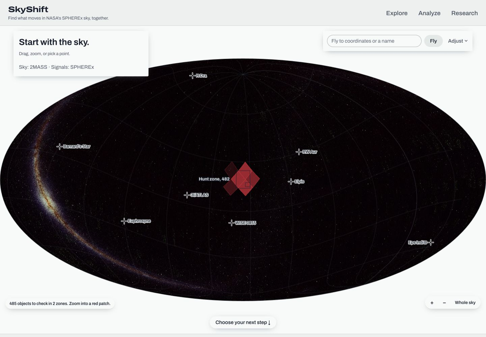
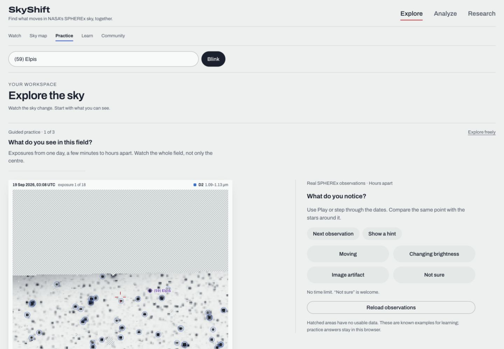

# SkyShift: sky map, scientific workspace and guided practice

An English-language guide to the integrated SkyShift workspace, its observation game,
scientific features, and release status.

**Branch:** `codex/science-production-integration`

**Latest local checks:** 1,656 tests passed; eight optional tests skipped; production build passed.
See [branch CI](https://github.com/cucuradu/skyshift/actions?query=branch%3Acodex%2Fscience-production-integration)
for remote checks of each pushed commit.

**Status, 14 November 2026:** source pushed and CI passed. This integration has not been
merged into `main` or deployed to the public site. A source push does not update
[skyshift.web.app](https://skyshift.web.app/).

## What this integration adds

SkyShift connects real NASA SPHEREx observations with tools for watching changes,
measuring evidence, and inspecting how results were produced. This branch incorporates
upstream `main` through `3cfc1c8`, including measured image overlays, candidate vetting,
and MCP support, alongside the integrated scientific products.

The website opens on a large, interactive **sky map**, with no area preselected.
Drag, zoom, search for a featured name, or pick a point. Search, Fly and zoom remain
visible; projection, coordinates, display layers and search-run overlays live in **Adjust**.
The overview starts with real 2MASS colour imagery and SPHEREx signal markers, labelled
on the map. SPHEREx and AllWISE backgrounds are available in Adjust. The search-run
overlay starts off so the map is easier to read.

When ready, choose **Explore**, **Analyze**, or **Research** from the header or the
three paths immediately below the map. There is no timer or required introductory
task. The chosen point, featured object, or map centre carries into the observation
workspace. Clicking the SkyShift logo returns to the previous sky view in this session.
The map uses degrees; observation fields use the supported 5′ Months or 20′ Hours
selection, rather than reusing the atlas's wide field of view.

Inside each area, the next navigation row shows only its functions. All areas remain
freely accessible, and guided practice remains an optional Explore activity.



[Mobile sky map](docs/previews/workspace/sky-home-mobile.jpg) ·
[The three paths below the map](docs/previews/workspace/sky-home-paths.jpg)

| Area | Functions in its navigation |
| --- | --- |
| Explore | Watch, Sky map, Practice, Learn, Community |
| Analyze | Measurements, Candidates, Review |
| Research | Data & methods, Live search, Results, Tools & API |

The observation tools inside Watch, Measurements, and Data & methods share one player.

| View | Purpose | Route |
| --- | --- | --- |
| Explore | Watch the sky change, read a concise target summary, and start guided practice. | `#/explore` |
| Analyze → Measurements | Inspect Motion, Spectrum, Light curve, Compare bands, Cross-match, or Signals. | `#/analyze/<section>` |
| Research → Data & methods | Inspect Data, Processing, Validation, Sensitivity, or Export. | `#/research/<section>` |

Switching between the three observation views preserves the target, detector,
clock, current frame, and selected position. Analyze and Research remember their last
selected section during the session. Changing the target clears stale scientific results.

The root entry and `#/sky` open the common sky map. Direct area links include `#/explore/sky`,
`#/explore/learn`, `#/analyze/candidates`, `#/analyze/review`, `#/research/live`,
`#/research/results`, and `#/research/tools`. Existing sky-coordinate, candidate,
filtered-list, lesson, and scientific links remain usable. Sky links open the neutral
map; other feature links select their parent area. Embedded observation links retain
their original player entry.
The former `#/explore/science` link opens Research → Data & methods → Processing.

## Guided observation game

Choose **Try guided practice** in Explore, or open `#/explore/play`.
The activity uses real prepared SPHEREx observations in the shared player.

1. **Elpis:** follow an asteroid through exposures on the Hours clock.
2. **Barnard's Star:** inspect a small positional shift between visits on the Months clock.
3. **RW Aurigae:** inspect brightness changes between visits.

Each example offers **Moving**, **Changing brightness**, **Image artifact**, and
**Not sure**. Users can play the images, step to the next observation, reveal a hint,
or use **Show changes** to inspect an image difference. Feedback explains the known
example before the user continues.

Answers open only after at least two image arrays have loaded for the expected target,
detector, clock, and field of view. If the observation changes, the activity asks the user
to return to the practice target. Hatched image regions have no usable data.

On desktop, the image and observation choices sit alongside each other. On mobile,
the task appears before the image, followed by the controls, choices, and feedback.

Progress is saved in the current browser and can resume after a refresh. A completion
recap links to real candidate review or Analyze. Practice answers are never submitted
as scientific votes. There is no timer, user ranking, or discovery score; uncertainty
is a valid response. Real candidates require follow-up and have no practice answer key.



[Mobile layout](docs/previews/workspace/practice-mobile.jpg)

## Scientific features

- Motion measurements and comparisons with Gaia, with uncertainties and quality notes.
- Spectra, reference spectra, light curves, and paired detector comparisons.
- Published static sky models, model residuals, and DR1 reference differences.
- Motion and cold-source candidate checks, catalogue queries, and sensitivity estimates.
- Source metadata, validation results, and supported scientific exports.
- Experimental halo light curves, synthetic W1/W2 products, and spectral audio, with
  their method and interpretation limits retained.

Historical asterisms, guest stars, and planetary events live separately at
`#/learn/stories`. They do not change scientific measurements or candidate assessments.

### Data paths and supported coverage

| Product | Location or service | Scope |
| --- | --- | --- |
| Canonical observations and object measurements | `web/public/data/`, then the bounded live API | Featured targets use prepared files; other supported coordinates use the existing live service. |
| Integrated scientific products | `web/public/science-data/` and the scientific API | Five published science fields; availability depends on detector and product. |
| Practice progress | Browser storage | Local learning activity; no Firestore practice votes. |
| Real flags and votes | Existing voting service | Separate from practice; the UI discloses browser-local mode when Firebase is not configured. |

The five published science fields are Barnard's Star, Epsilon Indi B, WISE 0855−0714,
RW Aurigae, and R Draconis. Published derived image layers support the **5′ Months**
selection. Their actual analysis footprint is approximately **4′**, with missing edges
masked. They are not arbitrary-field or Hours products.

Original observations and canonical object measurements retain their existing data paths.
The derived science products do not replace the raw observations or redefine their grid.
Portable products are included in the API container and do not require private pickle,
NPZ, or original prototype caches.

### Scientific limits

- Legacy analysis products do not retain complete quality flags; their candidate leads
  remain unvetted. Catalogue query support does not mean every candidate has been vetted.
- Cold-source false-alarm estimates remain uncalibrated. Background frequencies are not
  probabilities that a candidate is real.
- R Draconis has reference-difference image coverage but no reliable reference aperture
  spectrum in the published products.
- Sensitivity estimates do not establish a discovery or exclude Planet X.
- Known-object recovery checks apply to their documented samples and selection rules;
  they do not establish the precision of unknown candidates or the completeness of a
  distant-planet search.
- Live CatWISE and NEOWISE smoke checks encountered an upstream 502 and a timeout.
  Successful cloud-side checks are still outstanding.

New-field background science jobs must remain disabled in the current multi-worker
Cloud Run service with `SKYSHIFT_ENABLE_SCIENCE_JOBS=0`. The optional local queue needs
shared storage and distributed coordination before it can safely support cloud workers.
The existing canonical live observation API remains separate from that queue.

## Run the integrated version locally

Requirements: Node.js 22 or compatible, Python 3.12, and [uv](https://docs.astral.sh/uv/).
From a checkout of this repository:

```sh
git switch codex/science-production-integration
uv sync --project server --locked
(cd web && npm ci && npm run build)
SKYSHIFT_ENABLE_SCIENCE_JOBS=0 PORT=8083 bash scripts/run-local.sh
```

Open the [sky map](http://127.0.0.1:8083/), [Explore](http://127.0.0.1:8083/#/explore) or
[guided practice](http://127.0.0.1:8083/#/explore/play).
The local server serves the production build and API from the same origin.

For frontend development, keep the API running on port 8083 and run `npm run dev`
inside `web/`. Vite serves port 5173 and proxies `/api` to port 8083 by default;
`SKYSHIFT_API` can select another API origin.

Firebase configuration is optional for local inspection. Without `VITE_FIREBASE_*`
settings, real flags and votes use the disclosed local mode. Guided practice does not
require Firebase authentication.

## Validation

The sky-entry revision passed **1,656 tests locally**, with eight optional skips:

| Suite | Passed |
| --- | ---: |
| Web | 855 |
| Server | 312 |
| Core | 61 |
| Pipeline | 292 |
| MCP | 77 |
| Scientific helpers | 19 |
| Validation utilities | 40 |

The TypeScript check and Vite production build passed. The existing JavaScript bundle
size warning remains. The earlier [application baseline CI](https://github.com/cucuradu/skyshift/actions/runs/43624341717)
passed; the branch CI linked above reports the subsequent navigation revision separately.

Browser verification covered all three practice examples, hints and differences,
uncertainty feedback, refresh/resume, completion, and transitions into Analyze and
Research. All three areas were checked at 320px without horizontal overflow, and the
390px practice layout retains the task before the image. Regression tests cover the
observation readiness gate, wrong-target handling, progress recovery, shared player,
area selection for legacy links, and returning to a filtered candidate list.
The sky-entry checks additionally cover the neutral root, saved map return, selected
target/point handoff, precise-coordinate history and degree/arcminute field handling.
The sky map fits desktop, 390px and 320px widths without horizontal overflow.

To run the checks:

```sh
(cd web && npm test && npm run build)
for area in core pipeline server mcp scripts/science scripts/validate; do
  (cd "$area" && uv run --locked pytest -q) || exit 1
done
```

These engineering checks complement the scientific validation reports. They do not
substitute for independent scientific confirmation or a cloud deployment smoke test.

## Publication and handoff

The integration is pushed to GitHub. **It is not yet merged into `main` or published
to the production site.** Firebase authentication for the existing project remains
outstanding. The current change is a frontend release and uses the existing API.
Scientific views that depend on additional backend capabilities need availability
checks against that API before Hosting promotion.

The release owner should:

1. Use an account authorized for the existing `nasa-glazing` project and `skyshift` site.
2. Capture the current Firebase Hosting release for rollback.
3. Test a Hosting preview against the existing API, including the original sky route,
   all three areas, practice, supported scientific products and exports, and clear
   unavailable states for unsupported backend features.
4. Publish the tested frontend with `infra/firebase/deploy.sh hosting`, verify the
   public routes, and restore the prior Hosting version if those checks fail.

See the [integration and release record](docs/science-production-integration.md) for
coverage, earlier checks, and release gates; [API contracts](contracts/api.md) for data
shapes and units; and [MCP setup](mcp/README.md) for assistant access.

## Data and credits

Observations come from NASA SPHEREx DR1 and QR3 through NASA/IPAC IRSA. Gaia DR3 supplies
reference astrometry, while known-object checks use the documented external catalogues
and Minor Planet Center orbits. Existing acknowledgements, software licences, and data
credits remain in the [project README](README.md#data-and-credits).
