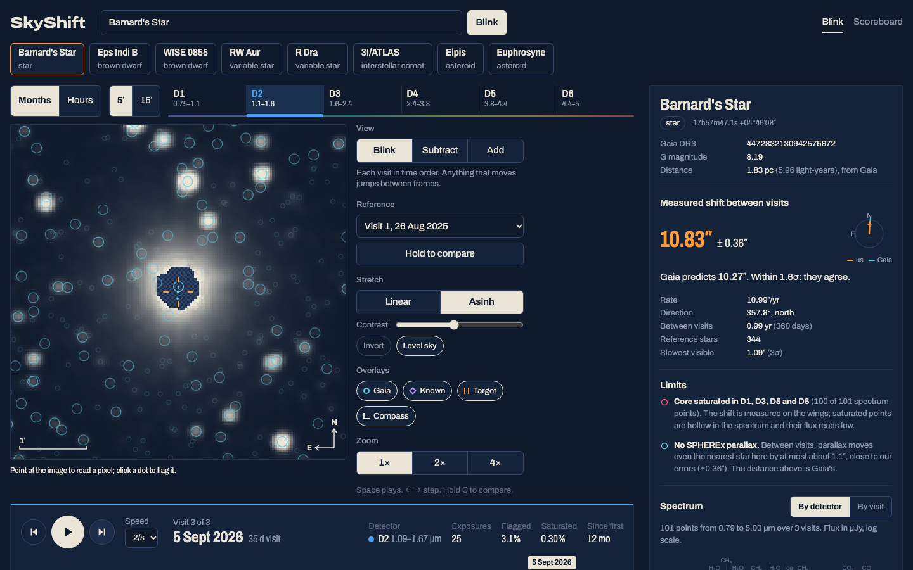

# SkyShift

**Blink NASA's SPHEREx infrared sky, measure what moved, and check it against Gaia.**

**Workspace integration:** [Three views, guided practice, local setup and release status](README-WORKSPACE.md).
This branch includes the integrated workspace and game; deployment to the public site is still pending.

SkyShift is a web tool built for the NASA Space Apps Challenge 2026, challenge "Planet X and SPHEREx".
You paste sky coordinates and it plays that patch of the SPHEREx sky as a short movie, so anything
that moved jumps between frames. Under the movie it measures how far the object moved and compares
that with ESA Gaia's prediction, builds the object's spectrum from all six SPHEREx detectors, and
lets anyone flag a dot and vote on what it is. Everything shown is real SPHEREx data from NASA/IPAC IRSA.

- **Site:** https://skyshift.web.app
- **How we know it works:** https://skyshift.web.app/#/score
- **Video (29 s):** link added after upload
- **Repository:** https://github.com/cucuradu/skyshift



## How to use it

1. **Paste coordinates** in the box at the top and press **Blink**. It accepts the challenge's own
   format (`08h55m10.831s -7d14m42.53s`) and decimal degrees (`133.7597 -7.2422`). Or click one of
   the eight featured targets.
2. **Blink.** Pick the clock, the field of view and one of the six detectors (D1–D6). Switch the view
   between Blink, Subtract (each frame minus a reference) and Add. Hold **C**, or the
   "Hold to compare" button, to flip between two frames.
3. **Measure.** The card on the right gives the measured shift, its error, the direction, the
   rate per year, and Gaia's prediction for the same dates. It also lists the limits of that
   measurement, the spectrum by detector or by visit, and the brightness by visit.
4. **Flag and vote.** Click a dot in the movie, then **Flag it**. Anyone can vote on a flagged dot:
   Mover, Changing, Junk or Not sure. **Download CSV** exports the candidates near the view with their
   vote counts, and the panel links to the Backyard Worlds forum for a second opinion.

The view lives in the URL (`?ra=&dec=&clock=&fov=&det=`), so every blink can be shared. Add
`&embed=1` to hide the page header and footer when you put a blink inside another site.

## Two clocks

SPHEREx sees each spot of the sky in bursts: a visit of 2–4 weeks every six months, made of about 21
sessions of 1–5 exposures. Slow and fast objects need different frames, so SkyShift has two clocks.

- **Months.** One median stack per visit and detector, about six months apart. Nearby stars and
  brown dwarfs step across the field. The stack also removes asteroids and cosmic rays.
  Field of view 5′ (3× oversampled) or 15′ (2×).
- **Hours.** Single exposures inside one visit, in time order. Comets and asteroids cross the field.
  Field of view 20′ (native 6.15″ pixels) or 60′ (binned 2×).

Brightness is compared only within one detector, because each SPHEREx exposure sees a spot at a
different wavelength. A change from D1 to D6 is colour, not motion.

## What is measured, and how we checked it

Every check is on the scoreboard at [#/score](https://skyshift.web.app/#/score), read from
`web/public/data/validation.json`, with the poor numbers printed too. On 14 November 2026,
8 of 11 checks pass, 1 is partial and 2 were cut. Measured on real SPHEREx data (DR1 + QR3):

| Check | Result |
|---|---|
| V1 Five test objects found | 5 of 5, in 19 of 20 visits; median offset 0.21 px (1.3″) from the predicted position |
| V2 Motion matches Gaia | Barnard's Star moved 10.83″ ± 0.36″ at position angle 357.8° in 0.986 yr; Gaia predicts 10.27″ (+5.5%, 2.2°). Epsilon Indi B 6.05″ ± 0.42″ vs 6.49″ (−6.7%). WISE 0855−0714 7.05″ ± 0.90″ vs 8.06″ from published astrometry (−12.6%) |
| V3 Position error | 0.36″ from 344 quiet Gaia stars around Barnard's Star; 0.36–0.90″ across the five fields |
| V4 Known asteroids, targeted | 60 of 60 asteroids re-found where IRSA's Moving Object Search Tool predicted them, in 249 of 300 photos; the same test 3′ away hit 3 of 300 photos (1.0%) |
| V5 Known asteroids, blind | 12 deg² pilot (990 photos): 63 of 68 asteroid sessions brighter than V 16 found as movers (93%); control 0% |
| V8 Spectra | SPHEREx ÷ 2MASS Ks 1.010 (scatter 3.0%, 3,918 stars); ÷ WISE W1 0.994 (scatter 1.8%, 4,240 stars) |
| V9 Proper motions | 32,446 pilot stars against Gaia: bias 20 and 0 mas/yr, scatter 216 and 240 mas/yr, pull scatter 0.96 and 1.07 |
| V10 Galaxy distances | 1,227 galaxies brighter than K AB 17 against SDSS DR17: σ_NMAD 0.023, 2% outliers |
| V11 Asteroid sizes | 11 asteroids: diameter 1.06× the published value on the median (scatter 14%); albedo 0.71× (ours run low) |

**Pending, said plainly:**
- V6 (fast Gaia stars) and V7 (known brown dwarfs) were cut in the one-day build.
- V8's speed test (time to the first frame for 10 random coordinates) has not been run against the
  deployed site. One test on 14 November gave frames for RA 150.1°, Dec +2.2° in about 9 s.
- The 100 deg² hunt zone has not finished, so the list of unknown movers on the scoreboard is empty.
- No SPHEREx parallax: between two visits parallax moves even Barnard's Star by at most about 1.1″,
  close to our errors. The card shows Gaia's distance instead.
- Bright stars saturate. Barnard's Star is saturated in 100 of its 101 spectrum points, RW Aurigae in
  291 of 319; shifts are measured on the wings. R Draconis has no spectrum on the site yet.

## How it works

```
IRSA image search ─► cutouts (IRSA, or the S3 copy) ─► visit rule, median stack, measure ─► 16-bit frames + JSON
  featured targets: scripts/precompute ─► static files on Firebase Hosting (/data/<slug>/)
  any coordinates:  FastAPI on Cloud Run ─► cached in Cloud Storage
ESA Gaia DR3 · IRSA MOST · IRSA 3I/ATLAS table · MPC orbits (kete) ─► same API, cached
Flags and votes ─► Firestore (create-only rules)
```

Frames reach the browser as 16-bit arrays, not pictures. The browser does the stretch, invert,
subtract and add, so a move smaller than one 6.15″ pixel stays visible. The site reads the static
files first and calls the API only for other coordinates. A separate pipeline (`pipeline/`) reads
each SPHEREx photo once from NASA's public S3 copy and keeps only the measured dots (about 4.5 MB of
the 56 MB read); it produced the V5 and V8–V11 numbers.

## Run it locally

You need Git, Node 22, Python 3.12 and [uv](https://docs.astral.sh/uv/).

```sh
# Web app: the featured targets work from static files, without the server
cd web && npm ci && npm run dev           # http://localhost:5173

# API for any coordinates (the dev server proxies /api to port 8000)
cd server && uv sync && uv run uvicorn skyshift_server.app:app --port 8000
```

The server caches in `~/.cache/skyshift` unless `SKYSHIFT_CACHE` is set. Without the Firebase
settings (`VITE_FIREBASE_*` in `web/.env`) the vote panel runs in local mode: flags and votes stay
in your browser.

### Use SkyShift from an AI assistant (MCP)

`mcp/` is an MCP server that lets Claude, Cursor or any MCP client browse the candidates, look at
blink frames (as images), measure motion and check known asteroids. It reads the public site, so
it needs no key and runs on your machine:

```sh
claude mcp add skyshift -- uv run --project mcp skyshift-mcp
```

Then ask, for example, "Show me SkyShift's best fast mover that no known asteroid explains."
Tools and setup for Claude Desktop: [mcp/README.md](mcp/README.md).

Tests: `uv run pytest` in `core/`, `pipeline/`, `server/`, `mcp/` and `scripts/validate/`; `npm test` in `web/`.
Deploys also need the Google Cloud CLI and the Firebase CLI (`infra/`).

## Repository layout

| Folder | What it holds |
|---|---|
| `core/` | Shared science code: visit rule, flag masks, detection, centroids, shifts, photometry |
| `pipeline/` | The pilot run and the asteroid hunt zone on cloud machines |
| `server/` | FastAPI app on Cloud Run; builds blink frames for any coordinates |
| `mcp/` | MCP server: SkyShift's candidates, blink frames and measurements as tools for AI assistants |
| `web/` | Vite + TypeScript app: sky view, blink player, cards, votes, scoreboard |
| `scripts/` | Validation (`validate/`), static export of the featured targets (`precompute/`), science checks (`science/`) |
| `contracts/` | The interfaces every part agrees on: `api.md`, `flags.md`, `dots.md` |
| `fixtures/` | Small examples used in tests; the API examples in `fixtures/api/` are synthetic and marked `"synthetic": true` |
| `infra/` | Cloud machine, Cloud Run and Firebase Hosting scripts |
| `pitch/` | Project page text, video script, slides, screenshots and the submission checklist |
| `docs/` | Planning notes and research written before and during the event |

Plans: [concept plan](https://claude.ai/artifact/VECemCPhqjnSVDBnfqJyZd) and
[dev plan](https://claude.ai/artifact/GhfDcQevT69fDKDY8hXrxS); copies in `docs/`.

## Team

Four people at one local event. Roles, not names:

- **P1** Lead, science and pipeline: shared science code, the pilot, validation (V1–V11).
- **P2** Server and deploys: image search, cutouts, stacks, the live API, static featured targets, the 3I/ATLAS movie.
- **P3** Sky view and cards: coordinate box, Aladin sky view, object card, spectrum, scoreboard.
- **P4** Blink and votes: the blink player and both clocks, flag and vote, CSV, the pitch.

## Data and credits

- **NASA SPHEREx** Level 2 spectral images, DR1 and QR3, from NASA/IPAC IRSA: image search, cutouts,
  and the public copy at `s3://nasa-irsa-spherex`. Also the IRSA SPHEREx all-sky cube (HiPS),
  IRSA's Moving Object Search Tool (MOST) and IRSA's SPHEREx table for comet 3I/ATLAS.
- **2MASS** and **AllWISE** sky layers (HiPS) and the 2MASS and CatWISE2020 catalogues, served by IRSA.
- **ESA Gaia DR3** through the ESA Gaia Archive (partner data).
- **Minor Planet Center** orbits for known asteroids and comets, propagated with **kete** (BSD-3-Clause, first written at Caltech/IPAC).
- **SDSS DR17** spectroscopic redshifts and the **EAZY** templates (galaxy distances, V10);
  the NEATM thermal model (Harris 1998) for asteroid sizes (V11).
- **Aladin Lite 3.8.2** (CDS, GPL-3.0), loaded from jsDelivr at run time and not bundled, showing IRSA HiPS layers.
- **Google Cloud** (Cloud Run, Cloud Storage, Compute Engine) and **Firebase** (Hosting, Firestore).
- Libraries: astropy, astroquery, pyvo, sep, reproject, numpy, scipy, pandas, pyarrow, FastAPI, uvicorn, Vite, TypeScript, Vitest.
- Modelled on WiseView and the Backyard Worlds: Planet 9 project.

## Acknowledgements

This publication makes use of data products from the Spectro-Photometer for the History of the Universe, Epoch of Reionization and Ices Explorer (SPHEREx), which is a joint project of the Jet Propulsion Laboratory and the California Institute of Technology, and is funded by the National Aeronautics and Space Administration.

This research has made use of the NASA/IPAC Infrared Science Archive, which is funded by the National Aeronautics and Space Administration and operated by the California Institute of Technology.

This work has made use of data from the European Space Agency (ESA) mission Gaia (https://www.cosmos.esa.int/gaia), processed by the Gaia Data Processing and Analysis Consortium (DPAC, https://www.cosmos.esa.int/web/gaia/dpac/consortium). Funding for the DPAC has been provided by national institutions, in particular the institutions participating in the Gaia Multilateral Agreement.

SPHEREx data sets (IRSA): DR1 Spectral Images, doi:10.26131/IRSA678 · QR3 Spectral Images, doi:10.26131/IRSA662 · Spectral All-Sky Cube, doi:10.26131/IRSA679.

SPHEREx canonical papers, as listed on IRSA's SPHEREx mission page (https://irsa.ipac.caltech.edu/Missions/spherex.html):
- Mission: Bock et al. 2026, ApJ 999, 139 (https://ui.adsabs.harvard.edu/abs/2026ApJ...999..139B/abstract)
- Pipeline: Akeson et al. 2026, ApJS 285, 67 (https://ui.adsabs.harvard.edu/abs/2026ApJS..285...67A/abstract)
- Instrument and calibration: Korngut et al. 2026, arXiv:2603.29835 (https://ui.adsabs.harvard.edu/abs/2026arXiv260329835K/abstract)
- Sky simulator: Crill et al. 2025, ApJS 281, 10 (https://ui.adsabs.harvard.edu/abs/2025ApJS..281...10C/abstract)

Gaia: Gaia Collaboration, Prusti et al. 2016, A&A 595, A1 (the mission); Gaia Collaboration, Vallenari et al. 2023, A&A 674, A1 (Data Release 3).

## Use of AI ("Super Intelligence")

We used Claude (Anthropic) through Claude Code as a coding and research assistant. It wrote most
of the code from our instructions, helped us read NASA's documentation, and drafted text, including
this README and the files in `pitch/`. Commits made with it carry a `Co-Authored-By` line.

**What the team decided and checked.** The idea is ours: a WiseView-style blink for SPHEREx, with a
spectrum and a public flag-and-vote step. We chose the two clocks, the five test objects, the scope
cuts and the gates. We set the pass mark for every check before running it, read the results, and
kept the failing and partial ones on the scoreboard. We reviewed and merged every change, ran the
tests, and compared the numbers on the site with Gaia, IRSA MOST and the catalogues.

**Before and after kickoff.** Before 09:00 on Saturday 14 November 2026 we prepared only a cloud
account, planning notes (`docs/`) and repository configuration: the `CLAUDE.md` guides, the
interface contracts and the Claude Code settings. Claude helped write those too. All product code
was written after 09:00 on Saturday. The interactive demo inside the concept plan uses simulated
stars, predates the event and is not used in the product.

**Images.** Every screenshot, GIF and video we publish for this project is a capture of the running
site on real SPHEREx data; none is AI-generated, and none uses NASA logos. The numbers come from our
own output files (`web/public/data/`).

## Licence

Apache-2.0, see [LICENSE](LICENSE). Outside libraries and data keep their own licences.
