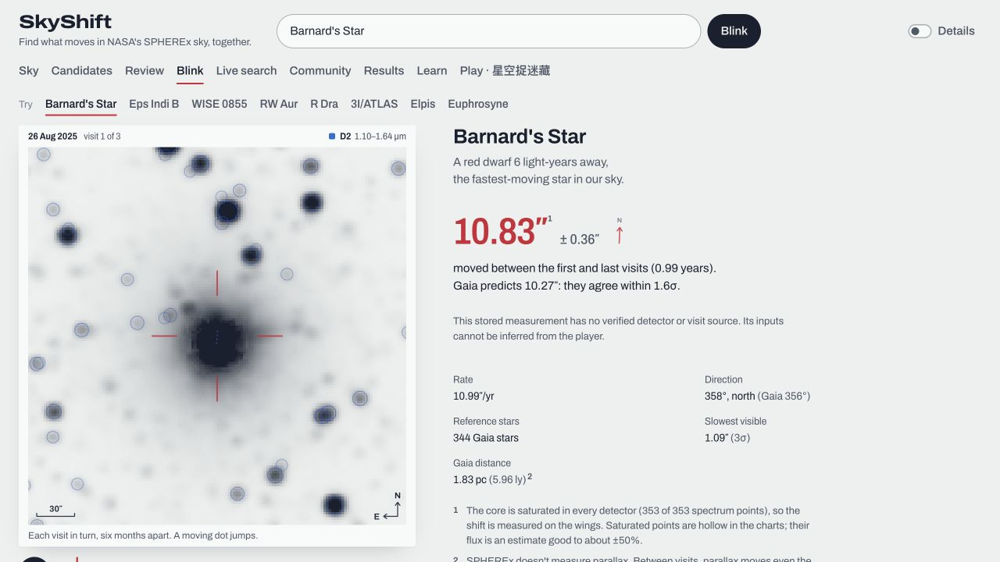
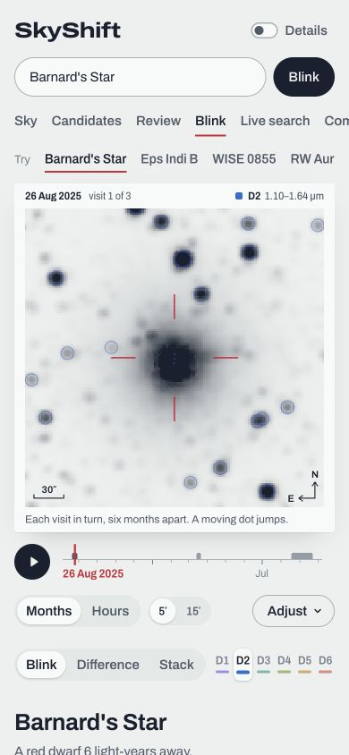
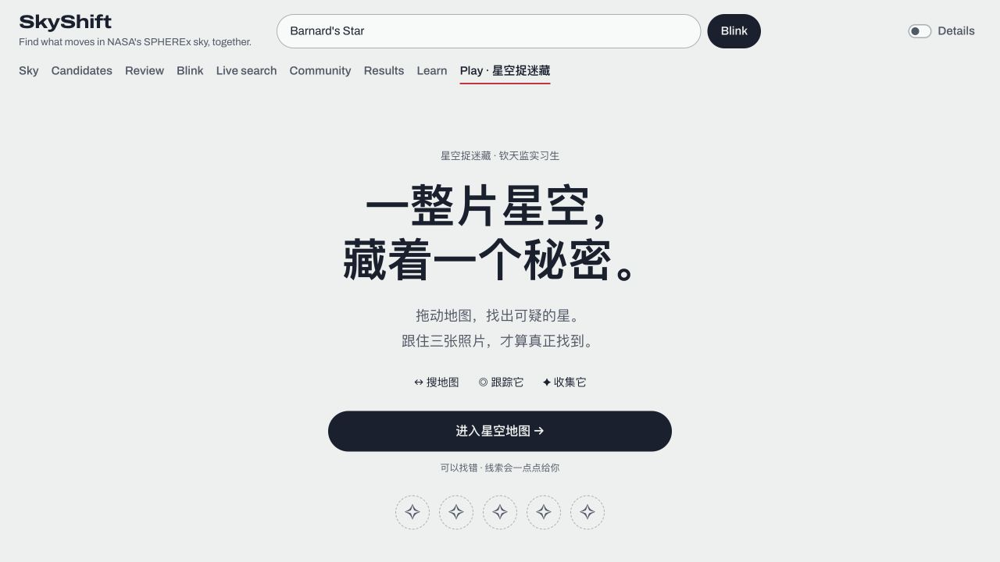

# Unified Lightbox frontend

The design baseline is the upstream main `b58c757` Lightbox frontend at `#/explore`. Integration is on `codex/frontend-unified`, in its own checkout. The original frontends and their uncommitted work remain available.

## Feature destinations

| Source feature | Unified destination |
| --- | --- |
| Lightbox sky atlas, target search, months/hours, detector and field controls | Original Sky and Blink pages |
| Blink, difference, stack, stretch, inversion, noise, overlays, zoom, pixel readouts | Original main player and Adjust controls |
| Candidates, filters, community review and votes, candidate detail | Original Candidates, Review and Community pages |
| Live search, evidence scoreboard, seven lessons, glossary, teacher material | Original Live search, Results and Learn pages |
| Analysis jobs, static sky model, model residual and DR1 reference difference | Blink → More ways to inspect this sky; layers use the same player |
| Motion/cold-source findings, false-alarm context, frame quality and published calibration | Same science disclosure; candidate Locate highlights the main plate |
| Paired D3/D6 images | Science disclosure → 短波 / 长波并排核查 |
| DR1 reference spectrum | Outlined points on the existing spectrum, with the same axes |
| Synthetic W1/W2 and experimental halo light curves, sonification | Science disclosure |
| Sensitivity, radius–distance models, Planet Nine and WISE 0855 reach estimates | Science disclosure; no unsupported exclusion claim |
| CatWISE, JPL objects, Gaia stars, NEOWISE relay, co-moving companions | Science disclosure; Gaia also updates the main plate and sky context |
| Analysis JSON, exposure CSV, blink GIF, ADES and MPC80 drafts | Science disclosure → 观测明细与导出 |
| Ancient asterisms, historical guests, remnant images, monthly planet events | Science disclosure → 古法寻星 |
| Five-target map game, three-image tracking, collection, birthday stars and cultural stories | Play · 星空捉迷藏 (`#/play`) |
| Backend playground requests, status/latency/bytes, raw JSON, checks, copy and session export | Tools and data → API inspector (`#/tools/inspector`) |
| Explicit synthetic fixtures and static/API source inspection | API inspector only; never substituted for real science observations |
| Candidate CSV/JSON/VOTable, batch coordinates, API examples and citations | Original Tools and data page |

The integration imports `130e950` and the existing product/learning work from the other local frontend. Its game is under `web/src/play`, preserving the Lightbox courses under `web/src/learn`. The obsolete dark app entry and global styles are removed from this checkout; one app shell owns every route. Extensions use the existing Lightbox tokens, capsule controls, negative astronomical plates and quiet disclosure sections.

## State and data boundaries

- A new target clears references, findings and quality immediately and aborts pending analysis/enrichment requests.
- Stale image loads cannot win after the next view begins. Hiding Blink or Play stops playback, including loads finishing after the route changes. Leaving the science panel stops audio.
- Non-raw layers resolve their own binary base URL. Missing layers show an explanation and return to observations. Static data missing the requested detector falls through to the API.
- The latest upstream bounded async frame/object builders are retained. Jobs and reference/export extensions use a separate local cache.
- Synthetic backend fallback requires explicit opt-in. The normal frontend rejects synthetic science responses.
- Optional measurement-source metadata retains the actual detector, visit pair, fit MJDs, counts, field, pixel scale and core treatment. Legacy measurements explicitly show unknown provenance instead of deriving it from the current player. This optional extension remains local; adopting it on the team main branch requires the existing contract review.

## Run locally

The active preview uses `http://localhost:5173/#/explore`, with the local API at `http://127.0.0.1:8083`. No cloud deployment or push to main was performed.

From this checkout:

```sh
uv sync --locked --project server
cd web
pnpm install --frozen-lockfile
pnpm build
cd ..
bash scripts/run-local.sh
```

This serves the built frontend and API on port 8083. In a second terminal, run `cd web && pnpm dev` for the requested 5173 development preview. `SKYSHIFT_API` overrides the Vite API proxy. `PORT` overrides the built service port; `SKYSHIFT_PYTHON` can select an existing Python runtime.

Precomputed raw observations and science models are tracked. `.runtime/jobs`, `.runtime/science` and `.runtime/api` are local, ignored caches: the current workspace has its own copies, while a fresh checkout must build an analysis before using endpoints that require these caches. Existing static examples work without them.

## Verification — 14 November 2026

| Suite | Result |
| --- | --- |
| Frontend Vitest | 484 passed, 40 files |
| TypeScript | Passed |
| Production build | Passed |
| Server, using its locked dependencies | 269 passed |
| Core | 54 passed, 1 network test skipped |
| Pipeline, using its locked dependencies | 160 passed, 2 network tests skipped |
| Scientific helpers | 19 passed |
| Validation utilities | 33 passed |

Total: 1,019 passing tests and 3 skipped network tests. Added checks exercise explicit measurement provenance, model detector fallback, hidden-page playback and stale image loads. The pipeline and core initially encountered missing dependencies/cache access in the reused environment; rerunning with the locked environment and permitted ephemeris cache resolved these environmental failures.

Browser checks covered the real Barnard and WISE 0855 observations, model/residual/reference-difference layers, shared DR1 spectrum, paired D3/D6 frames, published calibration evidence, cultural card and six historical images, map search and tracking, the original seven lessons, and the inspector's 3/3 API checks. Desktop and 390-pixel mobile layouts were inspected; the page had no horizontal overflow.

The build reports an initial JS chunk slightly over 500 kB; route splitting is a remaining performance improvement. Existing Python deprecation/runtime warnings do not fail the suites. Public catalogue services were not exhaustively queried and cloud behavior is not certified by these local checks. The Results/calibration pages show previously published scientific evidence; this merge does not establish new V6/V7 results or a Planet X exclusion.

## Preview captures






