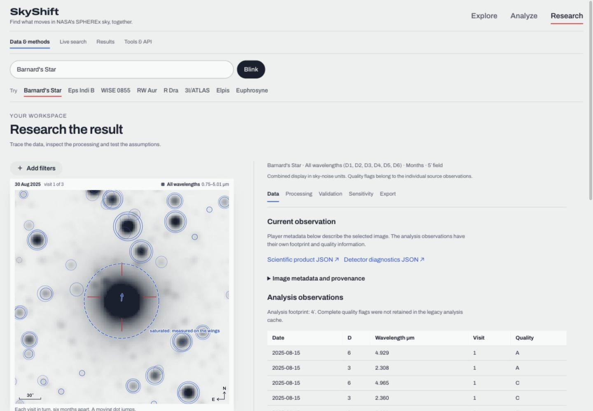

# Main and production API alignment

Checked 14 November 2026 against GitHub `main` through `86f5bf0` and the existing
service at [skyshift.web.app](https://skyshift.web.app/).

The main branch already contains the large neutral sky map and Explore / Analyze /
Research navigation. It also contains the newer all-wavelength player, colour filters,
measurement provenance, detector preservation, featured-target data and shared-link
fixes. This revision builds on that source and changes only frontend integration,
tests and documentation. No backend, infrastructure or API-contract edits are added.

The inspected public frontend still uses the earlier Sky / To check / Review / Blink
navigation and `/assets/index-WzvrJJsY.js`. Its data and API are newer than that UI.
GitHub source and deployed Hosting are separate release states. No production
deployment was performed during this alignment.

## Frontend compatibility fixes

- A legacy static `frames.json` without an index must match the requested field size.
  A 15′/60′ request cannot silently display a 5′/20′ image; mismatches use the existing API.
- Derived image requests reject `synthetic:true`, just as original observations do.
- Practice and model/residual/reference images stay within one detector. Ordinary
  observations retain main's All wavelengths preference, restored after practice.
  Pending raw detector responses cannot enter a locked derived display.
- Research describes actual loaded image constituents and resolved binary URLs.
  Noise-normalized composites are identified as such; individual-detector quality
  and physical units are not attributed to the whole composite.
- Detector diagnostics download the selected detector's analysis. An unsupported
  detector receives the API's unavailable response rather than another detector's file.
- A 404 unpublished product and an upstream/network loading failure have distinct
  feedback, while original observations and formal photometry remain accessible.
- Colour filters are disabled during practice and derived-image viewing. Switching
  into these states cancels active archive reads and clears the overlay. Returning
  to ordinary observations restores the filter controls without starting downloads.

## Production checks

All requests were reads against the existing service. No jobs, reference generation,
arbitrary-field builds, votes or deployment actions were submitted.

| Check | Observed result |
| --- | --- |
| Health and OpenAPI | Valid JSON; health reports engine version 5 and GCS cache. |
| Five targets' prepared indexes, objects and manifests, plus Barnard science products | 31 static JSON files matched the checked-out main byte for byte. |
| Barnard Months image | 42,632 bytes; equals width × height × 2 and matches the local binary. |
| Elpis Hours image | 76,050 bytes; equals width × height × 2 and matches the local binary. |
| Barnard scientific product API | 200, real scientific product JSON. |
| Barnard D2 analysis API | 200, `detector: 2`. |
| Barnard D6 analysis API | 404 with structured `not_found`; no D2 substitution. |
| Featured-name resolution | Barnard resolved successfully. |
| Invalid frame coordinates | 400 with structured `bad_request`. |
| Science capabilities | `analysis_jobs: false`; new-field computation stays hidden. |
| Live search | The actual GCS progress feed returned JSON. |

`/data/skyrun.json` and the obsolete `/data/targets.json` return the Hosting HTML
fallback. Current main does not request either as its data source. The frontend uses
the real progress feed and its bundled target catalogue.

External catalogue enrichment services were not exhaustively retested. Successful
prepared products do not establish arbitrary-field or new-field analysis support.

## Verification

| Suite | Passed |
| --- | ---: |
| Frontend | 1,089 |
| Server | 371 |
| Core | 61 |
| Pipeline | 328 |
| MCP | 88 |
| Scientific helpers | 19 |
| Validation utilities | 40 |

Total: **1,996 passed**, with eight optional skips. TypeScript and the production
build passed. The existing bundle-size warning remains.

Browser checks used the current frontend with `/api` proxied to the real production
service. They covered the three areas' active navigation, 390px and 320px layouts,
All wavelengths provenance, single-detector practice and derived images, filter
availability, restoring normal viewing, and unsupported-image fallback to observations.

[Mobile guided practice](previews/workspace/main-aligned-practice-mobile.jpg)

Hosting publication still requires a separately verified frontend release. The
current scope uses the existing API and does not include a backend deployment.
