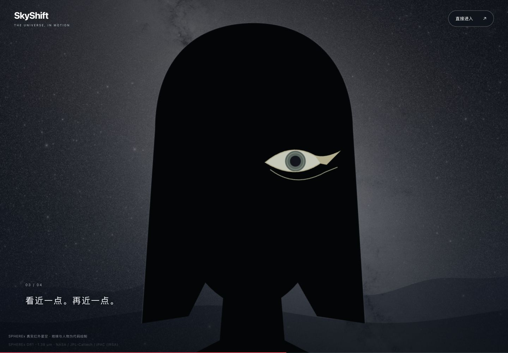
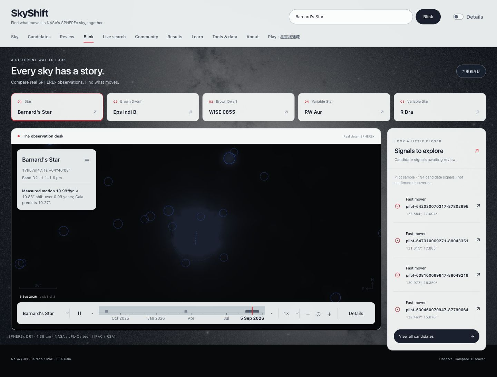

# Scroll opening and dashboard

Local implementation on `codex/frontend-unified`, 14 November 2026. No push or deployment.
The latest user reference supplies the dashboard's light gray panels, dark text, rounded
controls and red accents. It is a style reference, not a data source or an instruction to
replace the existing scientific tools. The latest correction uses a black, frontal silhouette
with one visible almond eye and extended liner inspired by ancient Egyptian murals. The camera
approaches the silhouette straight on, centers the eye, then enters its pupil.

## Camera and rendering

`web/src/intro/model.ts` maps normalized native scroll position directly to camera state.
The scroll container is 650 svh; requestAnimationFrame batches scroll/resize painting without
time-based interpolation. Scrolling backwards reverses the shot. Resize preserves progress.

| Progress | Scene |
| --- | --- |
| 0–0.25 | Real SPHEREx sky, title, enlarging shaded Earth |
| 0.25–0.45 | Cloud passage, night hills, standing girl |
| 0.45–0.70 | Frontal black silhouette, single visible eye, then pupil |
| 0.70–0.90 | Real sky visible through pupil, expanding to fill the screen |
| 0.90–1 | Search/header, five targets, existing player, candidate list reveal in order |

Canvas paths and gradients draw Earth, clouds and scenery. The figure is a flat black outline:
rounded crown, blunt hair, long neck and tapered robe. A single pale almond eye has a simple
iris and extended liner. There is no skin shading, nose, mouth, hair-strand texture or clothing
detail. Mobile face framing scales to viewport width and centers the eye before its close-up.
No video, AI-generated image, external character model or generated astronomical pixels are
used. Only the first screen's sky has slow ambient rotation; the
narrative camera is controlled by scroll. The sky stops rotating for the dashboard.

## Real sky and provenance

- Aladin Lite loads the existing [IRSA SPHEREx HiPS cube](https://irsa.ipac.caltech.edu/data/hips/SPHEREx/spherex_allsky_cube).
  D2's middle slice is approximately 1.38 μm. A 50° field near RA 266°, Dec −29° fills the backdrop.
- The already bundled Barnard's Star observation is the no-WebGL/CDN fallback and the loading
  eye texture. Its measured binary pixels are converted with the existing calibration helpers
  and display stretch; this does not change the science player or tracked observation files.
- Empty coverage in survey tiles remains empty. If both data paths fail, the page reports
  unavailable sky and retains the skip control rather than inventing stars.
- The discovery panel uses `candidateSet()`. A static candidate export wins; the existing
  development-only real pilot sample is clearly labeled. This checkout has no static candidate
  export, so the development preview shows **194 pilot candidate signals**, not confirmed discoveries.
  Production retains the explicit no-data state when there is no export.

## Routing and integration

Fresh `#/` visits enter the opening. `#/explore`, `?target=<known slug>`, legacy `?t=`,
coordinate links and embeds bypass it. Explicit Learn/Play and other page routes retain their
meaning. Completion or the persistent “直接进入” button records `skyshift:intro:v1:seen` and
enters `#/explore`. Storage failure is harmless. The dashboard's “重看开场” replays it in memory.
Reduced-motion users enter Explore immediately and get a static loading eye.

The dashboard rehomes the existing header/search and player DOM; there is still exactly one
live player and coordinate input. At progress 0.72 it starts preparing observations without
changing the route. During reveal the dashboard is inert and hidden from accessibility APIs;
completion activates the same DOM and focuses search. Light tokens apply only to entry/Explore;
Learn, Play and other pages retain their prior appearance and behavior.

Five featured buttons select the original target configurations. The original target selector
still includes every target. Scientific controls, analyses, data mappings and player geometry
are reused. The old Workspace action focuses the now-visible header search.

New sky requests get a 2.4-second looping pupil animation after a 160 ms debounce. It ends when
the request settles, without imposing an artificial delay. Request tickets prevent an older
completion from hiding a newer loader; leaving Explore hides it. Reduced motion disables spin.

## Verification

Final local results: **524 frontend tests in 47 files**, TypeScript check and production build
pass. The 36 new tests exercise phase boundaries/reversibility, native scroll and resize,
skip/seen/deep-link/reduced-motion routing, preloading without navigation, single player/search
ownership, real candidate links, request races and the measured no-WebGL sky fallback.

Required regression suites: core **53 passed / 2 skipped**, server **269 passed**, pipeline
**160 passed / 2 skipped**. Combined: **1,006 passed / 4 skipped**. Skips are external-network
checks. Existing Python warnings and Vite's mixed import / >500 kB chunk warnings remain;
this work does not certify external catalogue services or cloud deployment.

Actual browser checks covered desktop (1440×1000), phone (390×844), portrait/landscape progress,
forward/reverse scrolling, real IRSA sky, final handoff, WISE 0855 switching, Learn/Play routes,
deep links, seen-state skip and no horizontal overflow. Reduced-motion and request concurrency
were verified by tests; phone checks used a browser viewport, not physical hardware.

Run the existing Vite preview at <http://127.0.0.1:5173/>. Returning visitors can select
“重看开场”. See `frontend-unification.md` for local API and dependency setup.

These captures are screenshots of the running local tool, not generated concept art:

Additional captures: [landing](previews/intro/landing.jpg),
[phone ground scene](previews/intro/mobile-ground.jpg),
[phone dashboard](previews/intro/mobile-dashboard.jpg).
