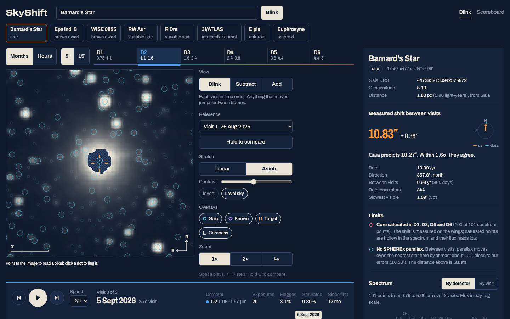
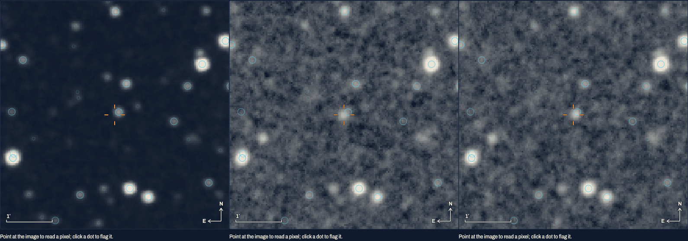
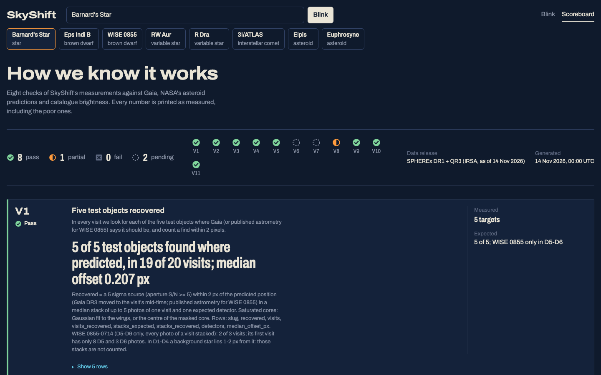
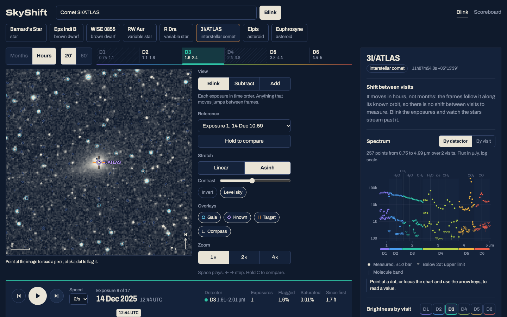

# SkyShift: Space Apps project page

Text for the fields of the team's Project tab on spaceappschallenge.org, in the order the form asks
for them. Paste each section into its field. Every number here comes from
`web/public/data/validation.json` or `web/public/data/<slug>/object.json` and was checked against the
live site on 14 November 2026. Images are in `pitch/screens/` (PNG, under 400 kB, upload limit 10 MB).

---

## Project name

SkyShift

## High-level project summary

*(140 words; the field asks for what we built, how it answers the challenge and why it matters.)*

SkyShift lets anyone blink NASA's SPHEREx infrared sky. Paste coordinates, including the challenge's
own format, and the site plays that patch as a short movie on two clocks: one stacked frame per visit,
six months apart, for nearby stars and brown dwarfs, or single exposures hours apart, for comets and
asteroids. Under each movie it measures how far the object moved and checks that against ESA Gaia.
On real SPHEREx data, Barnard's Star moved 10.83″ ± 0.36″ between two visits a year apart; Gaia
predicts 10.27″. We re-found 60 of 60 known asteroids where NASA's Moving Object Search Tool
predicted them. The site builds a spectrum on the fly from all six detectors, coloured by visit, and
anyone can flag a dot and vote on what it is. A public scoreboard prints all eleven checks, including
the two we cut.

## Link to project demo

*(The 29-second video on YouTube, unlisted or public. Add the link after upload and test it in a
private window.)*

## Link to final project

https://skyshift.web.app (the site links to the public repository, https://github.com/cucuradu/skyshift)

---

## Detailed project description

### The story

In 1930 Clyde Tombaugh found Pluto by blinking two photographs of the same sky taken days apart: the
stars stayed put and one dot jumped. Volunteers still find things the same way. The challenge page
notes that most known comets and brown dwarfs were found by volunteers, many of them through Backyard
Worlds, which blinks NASA's WISE images in a tool called WiseView.

Since 2025 NASA's SPHEREx has photographed the whole sky every six months in 102 infrared colours,
from 0.75 to 5 µm. That makes it a new set of photographs to blink. But its photos are hard to
compare by eye. Each exposure sees a spot at a different wavelength, so a plain blink flickers. And
the nearest moving stars shift by less than one 6.15″ SPHEREx pixel between visits.

SkyShift solves both. It stacks the photos of one visit and one detector, so the colours match, and it
sends the frames to the browser as 16-bit data, so a shift of under a pixel stays visible. Then it
puts a number under the movie. Anyone with a browser, on a phone too, can now blink SPHEREx.

### What it does

1. **Paste coordinates.** The box accepts `08h55m10.831s -7d14m42.53s`, the challenge's own string
   for WISE 0855−0714, and decimal degrees. Eight featured targets are one click away.
2. **Blink on the right clock.** Months blinks one median stack per visit; Hours blinks single
   exposures. Pick a detector (D1 0.75–1.1 µm to D6 4.4–5.0 µm), a field of view, and Blink,
   Subtract or Add.
3. **Read the measurement.** The card gives the shift between the first and last visit, its error,
   the direction, the rate per year and Gaia's prediction for the same dates, with the limits of that
   measurement written underneath. It also shows the spectrum by detector or by visit, with water,
   methane, CO₂ and CO bands marked, and the brightness by visit.
4. **Flag and vote.** Click any dot, then Flag it. Anyone can vote Mover, Changing, Junk or Not sure.
   The candidate list downloads as CSV and links to the Backyard Worlds forum.

Try it (each link opens the view it names):

- Barnard's Star: https://skyshift.web.app/?t=barnard&clock=months&fov=5&det=2
- WISE 0855−0714 in D6: https://skyshift.web.app/?t=wise0855&clock=months&fov=5&det=6
- Epsilon Indi B: https://skyshift.web.app/?t=epsindib&clock=months&fov=5&det=2
- RW Aurigae: https://skyshift.web.app/?t=rwaur&clock=months&fov=5&det=2
- R Draconis: https://skyshift.web.app/?t=rdra&clock=months&fov=5&det=2
- Comet 3I/ATLAS on the Hours clock: https://skyshift.web.app/?t=3i-atlas&clock=hours&fov=20&det=3
- Asteroid (59) Elpis: https://skyshift.web.app/?t=elpis&clock=hours&fov=20&det=2
- Any other spot, built live from IRSA: https://skyshift.web.app/?ra=150.1&dec=2.2&clock=months&fov=5&det=2
- The checks: https://skyshift.web.app/#/score

### Why two clocks

SPHEREx does not photograph a spot at random times. It sees each spot for 2–4 weeks every six months,
in about 21 sessions of 1–5 exposures taken 2.1 minutes apart. A nearby star moves a few arcseconds
between visits and not at all within one, so it needs frames months apart. An asteroid crosses
arcminutes in hours and is gone by the next visit, so it needs single exposures. One blink can't serve
both, so SkyShift has a switch: Months for stars and brown dwarfs, Hours for comets and asteroids.

### How it answers the challenge

| The challenge asks | What SkyShift does |
|---|---|
| Enter the coordinates of a patch of sky; see a series of images "like a little video" | The coordinate box is the first thing on the page. It accepts `08h55m10.831s -7d14m42.53s` and decimal degrees, and plays a movie on the Months or Hours clock. |
| Test on Barnard's Star, Epsilon Indi B, WISE 0855, RW Aurigae and R Draconis | Each is a one-click chip with real frames, a measured shift and a "what to look for" note. Check V1 found all five where predicted, in 19 of 20 visits. |
| Easy to update with new data | Any coordinates outside the featured targets are searched on IRSA live (DR1 and QR3), so weekly data appears without a code change. The scoreboard states the data release it used. |
| Use the 102 bands creatively; add each detector separately | One median stack per detector and visit (D1–D6). The spectrum uses every exposure's own wavelength: up to 453 points per object, by detector or by visit. |
| Generate spectra on the fly ("extra kudos") | Aperture photometry on every cutout, sorted by wavelength, coloured by detector or visit, with water, methane, CO₂ and CO bands marked. Saturated points are drawn hollow. |
| Add or subtract images taken at different times | Blink, Subtract (each frame minus a chosen reference, orange where light arrived, blue where it left) and Add, all in the browser. |
| Let users choose the field of view | 5′ or 15′ on the Months clock, 20′ or 60′ on the Hours clock. |
| Overlays from Gaia or WISE | Gaia DR3 stars moved to each frame's date, known asteroid positions, the target marker and a compass. The sky view below adds 2MASS, AllWISE and the SPHEREx all-sky cube from IRSA. |
| Coordinates in the URL, for embedding | Every view is in the URL (`?ra=&dec=&clock=&fov=&det=`); `&embed=1` hides the page header and footer. |
| Show metadata such as contamination flags | Each frame shows its date, detector wavelength range, number of exposures, and the share of pixels flagged by NASA's quality flags and saturated. Saturated cores are hatched. |
| Use Astropy and CDS Aladin | astropy, astroquery and pyvo on the server; Aladin Lite 3.8.2 for the sky view, with IRSA's HiPS layers because CDS's own services were down on 14 November. |
| Earth's orbit shifts nearby objects; motion measures distance | The card gives Gaia's distance and states why SPHEREx can't measure it yet: between two visits parallax is at most about 1.1″, close to our errors. Gaia's prediction includes parallax. |
| Planet X: things that move and aren't catalogued | A dot that moves and has no Gaia ring is the lead. WISE 0855 is the example: the coldest known brown dwarf, absent from Gaia, found in D5–D6. Our pipeline searches for such movers; its larger run is not finished. |
| Help as many people as possible pitch in | Flag any dot, vote, export CSV, and pass candidates to the Backyard Worlds forum. Works at phone width. |

### Measured results

All on real SPHEREx data, from the scoreboard at https://skyshift.web.app/#/score.

| Object or test | Measured | Expected | Note |
|---|---|---|---|
| Barnard's Star, visits 1→3 (0.986 yr), D2 | 10.83″ ± 0.36″ at 357.8° | 10.27″ at 355.6° (Gaia DR3, with parallax) | +5.5%, 1.6σ; core saturated, measured on the wings |
| Epsilon Indi B (1.418 yr) | 6.05″ ± 0.42″ at 125.7° | 6.49″ at 121.8° (Gaia DR3) | −6.7%; the pair is under 1″ apart, so it is one dot |
| WISE 0855−0714 (0.99 yr) | 7.05″ ± 0.90″ at 278.2° | 8.06″ at 274.8° (published astrometry) | −12.6%, 1.1σ; faint, seen only in D5–D6 |
| RW Aurigae, R Draconis | 0.31″ ± 0.50″ and 0.04″ ± 0.36″ | 0.03″ and 0.02″ | Both stay put, as expected |
| Five test objects (V1) | Found in 19 of 20 visits | 5 of 5 | Median offset 0.21 px (1.3″) |
| Known asteroids, targeted (V4) | 60 of 60, in 249 of 300 photos | Where IRSA MOST predicts | Median offset 0.77″; control 3′ away: 1.0% of photos |
| Known asteroids, blind (V5) | 63 of 68 sessions at V < 16 (93%) | 50% or more | 12 deg² pilot, 990 photos; control 0% |
| Brightness (V8) | 1.010 × 2MASS Ks, 0.994 × WISE W1 | 1.00 ± 20% | Scatter 3.0% (3,918 stars) and 1.8% (4,240 stars) |
| Proper motions (V9) | Pull scatter 0.96 and 1.07 | Near 1 | 32,446 pilot stars against Gaia; scatter about 0.2″/yr |
| Galaxy distances (V10) | σ_NMAD 0.023, 2% outliers | About 0.02 | 1,227 galaxies brighter than K AB 17, against SDSS DR17 |
| Asteroid sizes (V11) | 1.06 × published diameter | Near 1 | 11 asteroids, scatter 14%; our albedos run 0.71× |

The position error comes from the same cutouts: the scatter of quiet Gaia stars between visits is
0.36″ around Barnard's Star (344 stars) and up to 0.90″ in the sparser WISE 0855 field. That sets the
slowest motion we can see at 3σ in one year: about 1.1″/yr around Barnard's Star.

### Limits

- **Parallax.** Between two visits parallax shifts even the nearest star here by at most about 1.1″,
  close to our errors, so SkyShift does not claim a SPHEREx distance. The card shows Gaia's.
- **Saturation.** SPHEREx saturates on bright stars. The brightest unsaturated asteroid points we
  measured were AB 10.5 in D3, 10.9 in D4, 9.6 in D5 and 8.6 in D6; D1–D2 are not measured yet.
  Barnard's Star is saturated in 100 of 101 spectrum points and RW Aurigae in 291 of 319. Shifts are
  measured on the wings, and saturated points are hollow in the spectrum.
- **Variable stars.** Because of saturation, the brightness changes of RW Aurigae and R Draconis are
  not a measured result yet. R Draconis has no spectrum on the site.
- **WISE 0855.** Found in 2 of 3 visits; its first visit has only 11 photos in D5–D6. In D1–D4 a
  background star lies 1–2 pixels away, so the short-wavelength part of its spectrum is that star's light.
- **Epsilon Indi B** is a pair of brown dwarfs under 1″ apart: one dot, not two.
- **Which Planet X.** With 6.15″ pixels and two or three visits, SPHEREx can catch a nearby cold brown
  dwarf such as WISE 0855. A distant planet would be too faint and too slow. Our proper motions are
  good to about 0.2″/yr with two visits, so a search for fast stars needs a third.
- **Pending.** The 100 deg² hunt zone has not finished, so the scoreboard's list of unknown movers is
  empty. The speed test for random coordinates has not been run on the deployed site; one test took
  about 9 s to the first frame. Checks V6 (fast stars) and V7 (known brown dwarfs) were cut.

### How it works

- **Data path.** IRSA image search (astroquery) → cutouts from IRSA, or from NASA's S3 copy when IRSA
  is busy → the visit rule (a new visit after a 60-day gap) → a median stack per visit and detector
  → 16-bit frames and a JSON object card.
- **Featured targets** are static files on Firebase Hosting, so they load at once and keep working if
  a service is down. **Any other coordinates** go to a FastAPI server on Cloud Run, cached in Cloud Storage.
- **Measurement.** Centroids in each visit stack against quiet reference stars in the same cutout;
  saturated cores are fitted on the wings. Gaia DR3 positions are moved from epoch 2016.0 to each
  visit's mid-time. Spectra are aperture photometry on every cutout, in µJy.
- **Browser.** Vite and TypeScript, no framework. Stretch, invert, subtract and add happen on a canvas.
  Votes go to Firestore with create-only rules; each voter is a random id kept in the browser.
- **Pipeline.** A separate job reads each SPHEREx photo once from NASA's public S3 copy and keeps only
  the measured dots, about 4.5 MB of the 56 MB read. On a 12 deg² pilot it gave the V5 and V8–V11
  numbers. Whole-sky cost from the measured speed: about €75 of compute.
- **Languages and tools.** Python 3.12 (astropy, astroquery, pyvo, sep, reproject, numpy, scipy,
  FastAPI), TypeScript, Google Cloud, Firebase, Aladin Lite.

### After a vote

A flagged dot keeps its position, date, clock and detector. Votes are counted per answer. The
candidate list near any view downloads as a CSV (position, date, clock, vote counts) and links to the
Backyard Worlds forum, where volunteers and astronomers already check brown-dwarf candidates.

### What's next

- New SPHEREx data arrives weekly. The live search picks it up; a third visit for most of the sky
  will make the fast-star search possible.
- Finish the 100 deg² hunt zone and put its unknown movers on the scoreboard for people to vote on.
- Measure the saturation level in D1–D2 and the time to first frame for random coordinates.
- Run the pipeline beyond the pilot. The whole sky is costed at about €75 of compute, not yet run.
- Publish the measured dots and the candidate list with a DOI.

### Links

- Site: https://skyshift.web.app
- Checks: https://skyshift.web.app/#/score
- Code (Apache-2.0): https://github.com/cucuradu/skyshift
- Video: *(link after upload)*

---

## Use of Super Intelligence (SI)

We used Claude (Anthropic) through Claude Code as a coding and research assistant. It wrote most of
the code from our instructions, helped us read NASA's documentation, and drafted text, including this
page. Every commit made with it carries a `Co-Authored-By` line in the public repository.

The idea is the team's: a WiseView-style blink for SPHEREx, with a spectrum and a public
flag-and-vote step. The team chose the two clocks, the test objects, the scope and the cuts, set the
pass mark for each check before running it, reviewed and merged every change, ran the tests, and
compared the site's numbers with Gaia, IRSA MOST and the catalogues. We kept the cut and partial
checks on the scoreboard.

Before 09:00 on 14 November 2026 we prepared only a cloud account, planning notes and repository
configuration; all product code was written after kickoff. Every image and video on this page is a
capture of the running site on real SPHEREx data. None is AI-generated, and none uses NASA logos.

## NASA data

- SPHEREx Level 2 spectral images, Data Release 1 and Quick Release 3, from NASA/IPAC IRSA
  (image search, cutouts, and the public copy at `s3://nasa-irsa-spherex`).
- The IRSA SPHEREx all-sky cube (HiPS), shown in the sky view.
- IRSA's Moving Object Search Tool (MOST): predicted asteroid positions for V4 and the asteroid movies.
- IRSA's SPHEREx table for comet 3I/ATLAS: the comet's position in each image.
- 2MASS and AllWISE sky layers (HiPS) and the 2MASS and CatWISE2020 catalogues, served by IRSA.
- The SPHEREx Explanatory Supplement and the IRSA SPHEREx tutorials.

## Space agency partner data

- ESA Gaia DR3, through the ESA Gaia Archive: star positions, proper motions, parallaxes and
  magnitudes for the overlays, the predictions and the reference stars.

## Other references

- Minor Planet Center orbits for known asteroids and comets, propagated with kete (BSD-3-Clause, first written at Caltech/IPAC).
- SDSS DR17 spectroscopic redshifts; EAZY templates; the NEATM thermal model (Harris 1998).
- Aladin Lite 3.8.2 (CDS, GPL-3.0), loaded from jsDelivr.
- astropy, astroquery, pyvo, sep, reproject, numpy, scipy, pandas, pyarrow, FastAPI, uvicorn, Vite,
  TypeScript, Vitest, the Firebase JavaScript SDK.
- Google Cloud (Cloud Run, Cloud Storage, Compute Engine) and Firebase (Hosting, Firestore).
- WiseView and Backyard Worlds: Planet 9 (Kuchner et al. 2017), the model for the blink.
- Gagné et al. 2026, the SPHEREx ultracool dwarf library (arXiv:2604.22012): related prior work.
- Luhman & Esplin 2016, WISE 0855−0714 astrometry for the predicted shift.
- Claude Code (Anthropic), see Use of SI.

## Acknowledgements and citations

This publication makes use of data products from the Spectro-Photometer for the History of the Universe, Epoch of Reionization and Ices Explorer (SPHEREx), which is a joint project of the Jet Propulsion Laboratory and the California Institute of Technology, and is funded by the National Aeronautics and Space Administration.

This research has made use of the NASA/IPAC Infrared Science Archive, which is funded by the National Aeronautics and Space Administration and operated by the California Institute of Technology.

This work has made use of data from the European Space Agency (ESA) mission Gaia (https://www.cosmos.esa.int/gaia), processed by the Gaia Data Processing and Analysis Consortium (DPAC, https://www.cosmos.esa.int/web/gaia/dpac/consortium). Funding for the DPAC has been provided by national institutions, in particular the institutions participating in the Gaia Multilateral Agreement.

SPHEREx data sets (IRSA): DR1 Spectral Images, doi:10.26131/IRSA678 · QR3 Spectral Images, doi:10.26131/IRSA662 · Spectral All-Sky Cube, doi:10.26131/IRSA679.

SPHEREx canonical papers, as listed on IRSA's SPHEREx mission page (https://irsa.ipac.caltech.edu/Missions/spherex.html):
- Mission: Bock et al. 2026, ApJ 999, 139 (https://ui.adsabs.harvard.edu/abs/2026ApJ...999..139B/abstract)
- Pipeline: Akeson et al. 2026, ApJS 285, 67 (https://ui.adsabs.harvard.edu/abs/2026ApJS..285...67A/abstract)
- Instrument and calibration: Korngut et al. 2026, arXiv:2603.29835 (https://ui.adsabs.harvard.edu/abs/2026arXiv260329835K/abstract)
- Sky simulator: Crill et al. 2025, ApJS 281, 10 (https://ui.adsabs.harvard.edu/abs/2025ApJS..281...10C/abstract)

Gaia: Gaia Collaboration, Prusti et al. 2016, A&A 595, A1 (the mission); Gaia Collaboration, Vallenari et al. 2023, A&A 674, A1 (Data Release 3).
